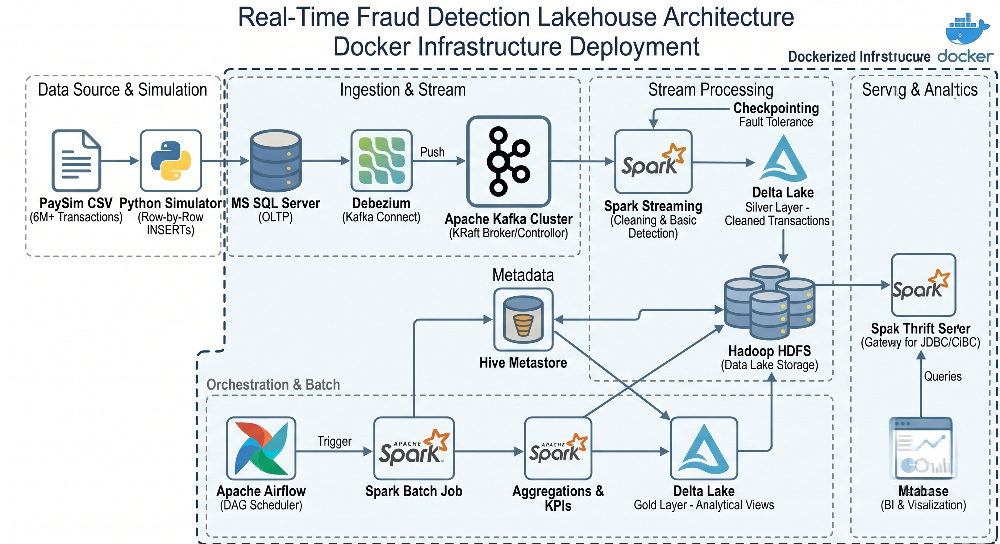
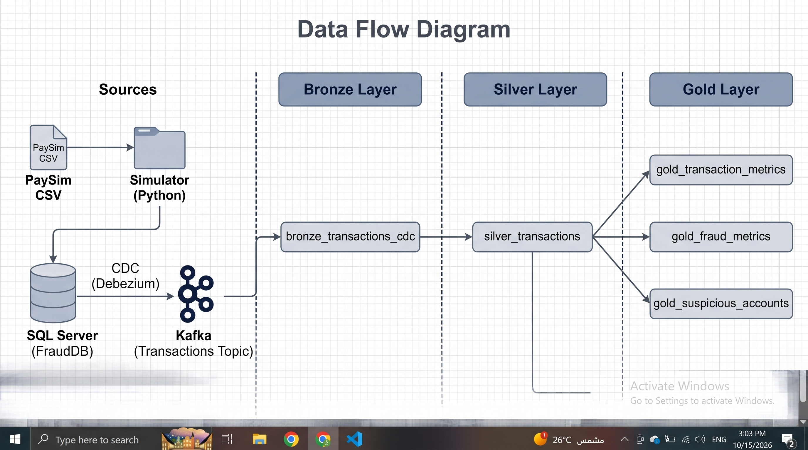

# Real-Time Fraud Detection Lakehouse

An end-to-end Data Engineering project that ingests financial
transactions, captures database changes, processes events with Spark
Structured Streaming, stores data in a medallion-style HDFS lakehouse,
and prepares Gold data marts for downstream SQL analytics.

## Architecture



### Data flow

1.  **Source data** --- a PaySim-style transaction CSV is read by a
    Python simulator.
2.  **Operational database** --- the simulator loads transactions into
    SQL Server (`FraudDB`, `dbo.Transactions`).
3.  **Change Data Capture** --- SQL Server CDC exposes row changes;
    Debezium captures them and publishes events to Kafka.
4.  **Streaming processing** --- Spark Structured Streaming consumes
    Kafka events and processes transaction changes.
5.  **Silver layer** --- cleaned and event-aware transaction data is
    stored as Delta Lake data on HDFS. The stream uses checkpointing for
    recovery/progress tracking.
6.  **Gold layer** --- a Spark batch job reads Silver, resolves the
    latest event per transaction, handles deleted records, applies
    validity filters, and writes analytical Delta marts to HDFS.
7.  **Orchestration** --- Airflow schedules the Gold batch job and
    provides task history, retries, and logs.
8.  **SQL access** --- Spark Thrift Server is configured to use the Hive
    Metastore and expose a JDBC/SQL endpoint. Gold table registration
    and queryability must be verified in the running environment before
    downstream consumers connect.



## Technology stack

-   **Python** --- transaction simulator and Spark job code
-   **Microsoft SQL Server** --- operational transaction database and
    CDC source
-   **Debezium** --- SQL Server CDC connector
-   **Apache Kafka (KRaft)** --- event transport
-   **Apache Spark 3.5.6** --- Structured Streaming and batch processing
-   **HDFS (Hadoop 3.3.6)** --- distributed storage for lakehouse data
-   **Delta Lake** --- ACID table format for Silver/Gold data
-   **Hive Metastore + PostgreSQL** --- table metadata catalog and
    metadata storage
-   **Apache Airflow** --- scheduled orchestration of the Gold batch job
-   **Docker Compose** --- local multi-container environment
-   **Kafka UI ** --- Kafka topic inspection

## 📊 Dataset

This project utilizes the **PaySim** dataset, a widely-used synthetic dataset that simulates mobile money transactions to train and evaluate fraud detection models.

You can download the raw data from Kaggle here:
[Synthetic Financial Datasets For Fraud Detection](https://www.kaggle.com/datasets/ealaxi/paysim1)

## Lakehouse layers

### Silver

The streaming job writes transaction events and applies
event/data-quality handling. The event model includes event identity
based on Kafka topic, partition, and offset, and distinguishes event
types such as inserts, updates, deletes, snapshot reads, malformed
records, and unknown events.

### Gold

The batch job (`gold_batch.py`) prepares analytical marts, including:

-   **Transaction metrics** grouped by step and transaction type
-   **Fraud metrics** grouped by transaction type
-   **Suspicious origin accounts**

## Repository structure

The main paths currently referenced by Docker Compose and the project
workflow are:

``` text
.
├── airflow/
│   ├── Dockerfile
│   └── dags/
│       └── gold_batch_dag.py
├── hive-metastore/
│   └── Dockerfile
├── sql/
│   └── init.sql
├── spark/
│   ├── conf/
│   │   ├── spark-defaults.conf
│   │   └── spark-thrift-defaults.conf
│   └── jobs/
│       ├── silver_stream.py
│       └── gold_batch.py
├── docker-compose.yml
├── .env                 # local secrets; do not commit
├── .env.example
├── Architecture_Diagram.jpg
├── Data-Flow-Diagram.jpg
└── architecture.png
```

Adjust this tree if your actual filenames differ.

## Prerequisites

-   Docker Desktop with Docker Compose
-   Enough RAM for SQL Server, Kafka, HDFS, Spark, Hive Metastore, and
    Airflow to run together
-   A local `.env` file containing the required configuration values
-   The transaction CSV used by the simulator, stored at the path
    expected by your simulator

## Configuration and secrets

Do **not** commit `.env`, database passwords, connector credentials,
tokens, or private datasets to GitHub. Commit a sanitized `.env.example`
containing placeholders instead.

## Running locally

Start the ingestion and processing services:

``` powershell
docker compose --profile ingest --profile process up -d --build
```

Start Airflow services:

``` powershell
docker compose --profile airflow up -d --build
```

Start Kafka UI only if you want to inspect Kafka topics:

``` powershell
docker compose --profile ui up -d
```

Check container status:

``` powershell
docker compose --profile ingest --profile process --profile airflow ps -a
```

Inspect logs for a service:

``` powershell
docker logs --tail 100 spark-silver
docker logs --tail 100 spark-thrift
```

> The exact simulator invocation depends on the Python entry point in
> your repository. Run the simulator using its actual script and
> configured CSV path.

## Data and orchestration notes

-   The Silver stream and the Gold batch job have different
    responsibilities: the stream processes incoming CDC events; the
    batch job builds analytical marts from the persisted Silver layer.
-   The Airflow DAG is configured to run the Gold batch job on a
    schedule. Confirm the DAG is enabled and has a successful run in the
    Airflow UI.
-   The Spark Thrift Server service is configured for a JDBC endpoint on
    port `10000`. Confirm the service is healthy, then verify that Gold
    tables are registered in Hive Metastore and visible through SQL
    before handing access to an analyst.
-   Local Docker socket access for Airflow is suitable for this
    development setup but grants substantial control over the Docker
    host. Do not expose this configuration as-is in a shared or
    production environment.
-   The Compose configuration uses single-node/local settings and
    replication factor `1` for development; it is not a highly available
    production deployment.

# 👨‍💻 Author

**Assem Osama**  
Computer Science & Artificial Intelligence Student | Data Engineering Focus

* 🐙 **GitHub:** [Assem-osama](https://github.com/Assem-osama)
* 💼 **LinkedIn:** [Assem Osama](https://linkedin.com/in/assem-osama-008a51268)